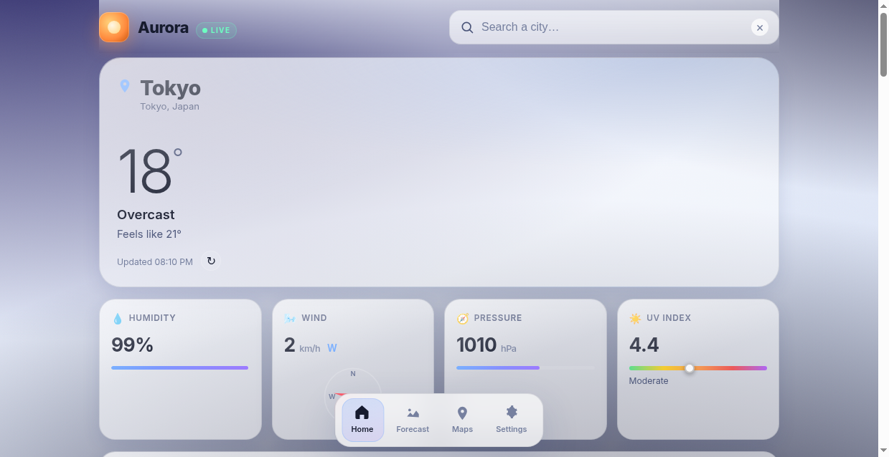
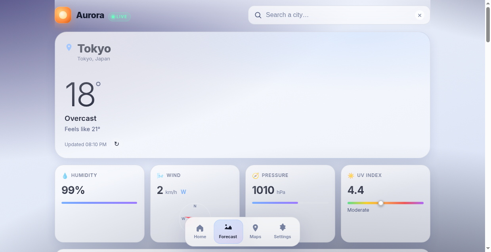
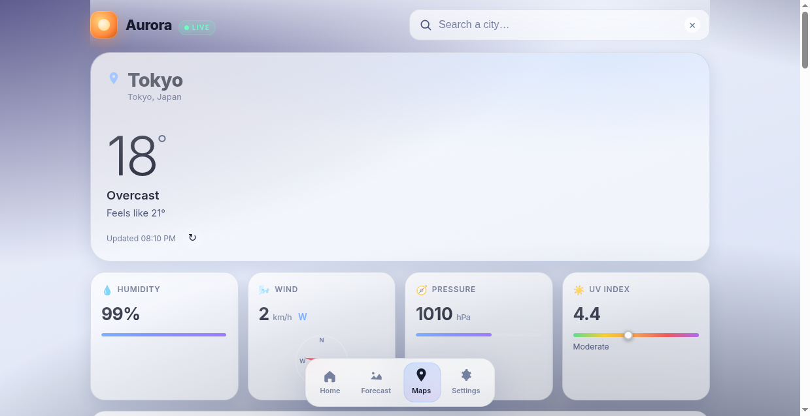
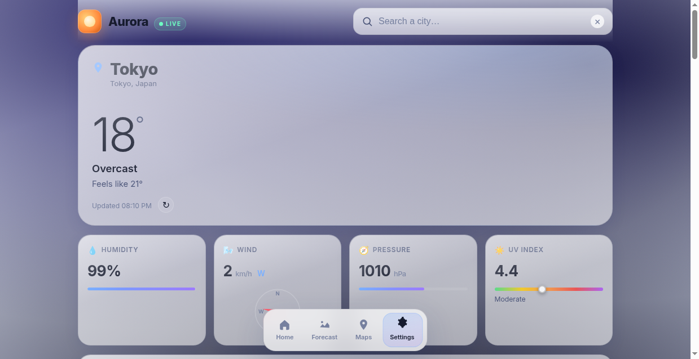

# Aurora Weather

A premium, multi-page weather app built with pure **HTML, CSS, and JavaScript** — glassmorphism design, animated weather icons, particle effects, SVG charts, and micro-interactions. No frameworks, no build step, no API key required.

> **Made with ♥ by Sudais Alam**

---

## Preview

<table>
  <tr>
    <td width="50%" align="center"><b>🏠 Home — Current Weather</b></td>
    <td width="50%" align="center"><b>📈 Forecast — 7-Day + Hourly</b></td>
  </tr>
  <tr>
    <td width="50%"></td>
    <td width="50%"></td>
  </tr>
  <tr>
    <td width="50%" align="center"><b>📍 Maps — Saved Cities</b></td>
    <td width="50%" align="center"><b>⚙️ Settings — Units & Theme</b></td>
  </tr>
  <tr>
    <td width="50%"></td>
    <td width="50%"></td>
  </tr>
</table>

---

## ✨ Features

### 4 Pages (SPA with hash router)
- **Home** (`#/`) — hero weather card, animated temperature, hourly strip, sun arc, wind compass, air quality
- **Forecast** (`#/forecast`) — 7-day forecast, animated SVG temperature chart, precipitation bars, expandable day rows
- **Maps** (`#/maps`) — saved cities grid (localStorage), live mini-temps, add/remove cities
- **Settings** (`#/settings`) — unit toggles (°C/°F, km/h/mph, hPa/mmHg), theme (Auto/Dark/Light), about

### Premium UI & Animations
- **Glassmorphism** — backdrop-filter blur, gradient sheen, soft shadows
- **Animated gradient background** that shifts with weather (clear/cloudy/rainy/snowy/night)
- **Particle effects** — falling rain streaks / snowflakes on a canvas overlay
- **CSS-only animated weather icons** — rotating sun rays, drifting clouds, falling rain drops, snowflakes, flashing lightning
- **Number count-up** — temperature & stats animate from 0 to value
- **Staggered card entrance** — cards fade-up with delay based on index
- **Page transitions** — slide + fade between routes
- **SVG charts** — animated temperature line chart (stroke-dashoffset draw), precipitation bars
- **Sun arc** — SVG path showing sunrise → current position → sunset
- **Wind compass** — rotating SVG needle showing wind direction
- **Bottom nav** — sliding indicator under active tab
- **Shimmer skeleton** loader while fetching
- **Live autocomplete** — debounced city search with keyboard nav (↑/↓/Enter/Esc)
- **Ripple effect** on buttons, **pulse** on LIVE indicator, **heartbeat** on credit
- **Keyboard shortcut** — press `/` to focus search bar
- **Refresh button** — re-fetch weather with a click

### Data
- **Open-Meteo API** (free, no key) — geocoding + forecast + air quality
- Current: temperature, feels-like, humidity, wind + direction, pressure, UV, precipitation, is_day
- Hourly: 24-hour temperature + weather code + precipitation probability
- Daily: 7-day forecast, sunrise/sunset + day length, UV index, precipitation sum
- Air quality: PM2.5, PM10, US AQI

---

## Quick Start

### Open directly
Double-click `index.html` — that's it.

### Local server (recommended)
```bash
python3 -m http.server 8000
# or
npx serve
```
Then open <http://localhost:8000>.

---

## File Structure

```
weather-app/
├── index.html       # SPA shell, 4 page sections, bottom nav
├── style.css        # Glassmorphism + all animations
├── app.js           # SPA router + API client + interactions
├── preview/         # Screenshots for README
│   ├── home-delhi.png
│   ├── home-tokyo.png
│   ├── forecast.png
│   ├── maps.png
│   └── settings.png
├── README.md        # This file (with embedded previews)
├── SETUP.md         # Detailed setup + customization + deployment
└── .gitignore
```

---

## Pages

### Home (`#/`)
- Animated search bar with live autocomplete (press `/` to focus)
- Hero card: city, count-up temperature, animated icon, condition, feels-like
- 4 stat cards: humidity, wind (with compass + cardinal direction), pressure, UV index
- 24-hour horizontal scroll strip
- Sun arc SVG (sunrise → current → sunset + day length)
- Air quality card (PM2.5, PM10, AQI badge)
- Refresh button (↻) to re-fetch weather

### Forecast (`#/forecast`)
- Animated SVG temperature line chart (7 days, stroke-dashoffset draw)
- Precipitation probability bar chart
- Expandable day rows with hourly detail

### Maps (`#/maps`)
- Saved cities grid (localStorage)
- Default cities: Delhi, London, Tokyo, New York, Dubai, Sydney
- Live mini-temps for each saved city
- Add/remove cities
- Click a card → loads that city on Home

### Settings (`#/settings`)
- Units: °C/°F, km/h vs mph, hPa vs mmHg
- Theme: Auto (day/night) / Dark / Light
- About + credit "Made by Sudais Alam"
- Clear saved cities

---

## Browser Support

Chrome, Firefox, Safari, Edge — requires JavaScript + `backdrop-filter` support.

---

## Credits

- **Developer**: Sudais Alam ([github.com/sudaisalamboy](https://github.com/sudaisalamboy))
- **Weather data**: [Open-Meteo](https://open-meteo.com) (free, open-source)
- **Font**: Inter by Rasmus Andersson
- **License**: MIT

---

## License

MIT — free to use, modify, and distribute.

## Keyboard Shortcuts

| Key | Action |
|-----|--------|
| `/` | Focus search bar |
| `Enter` | Search / submit |
| `Esc` | Close autocomplete dropdown |

## Changelog

- **v1.0** — Initial weather checker (HTML/CSS/JS)
- **v2.0** — Aurora redesign: glassmorphism, 4 pages, animations
- **v2.1** — Wind cardinal direction, day length, keyboard shortcut, refresh button
- **v2.2** — Search input clear fix, preview images
